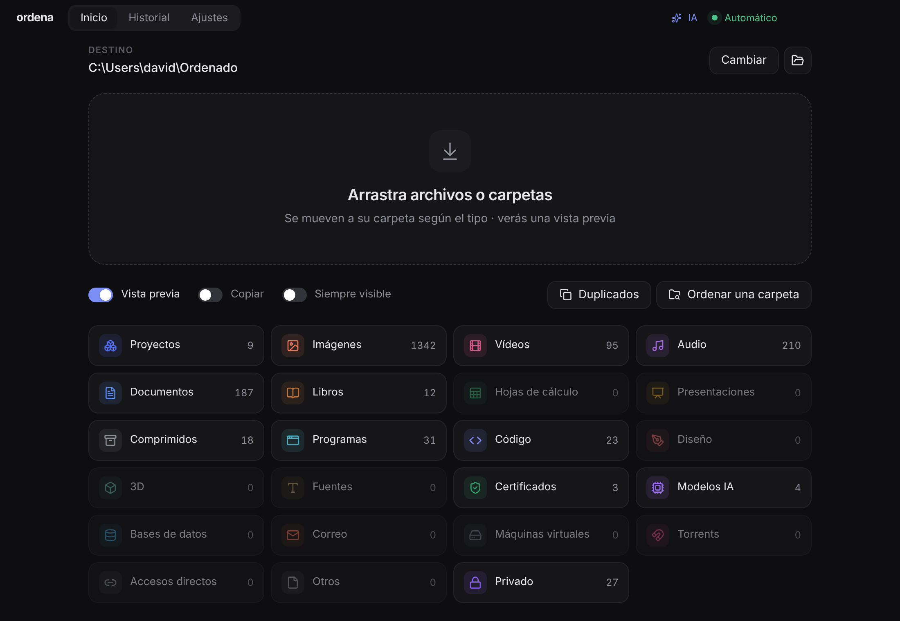
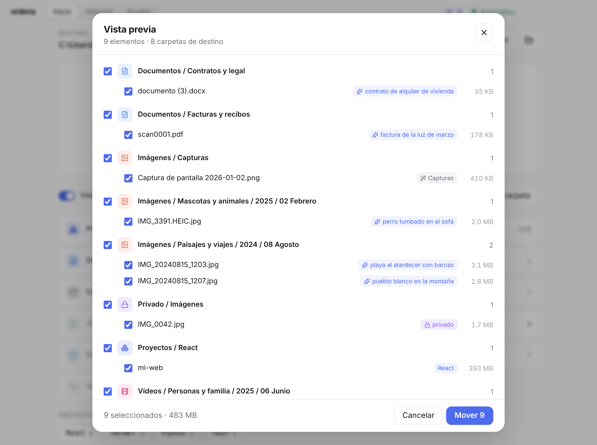
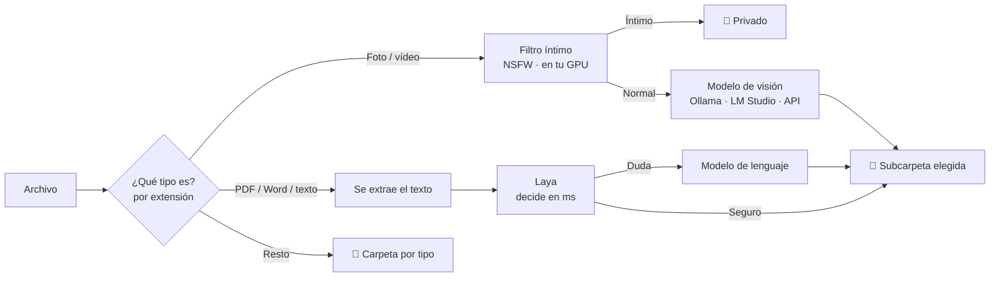
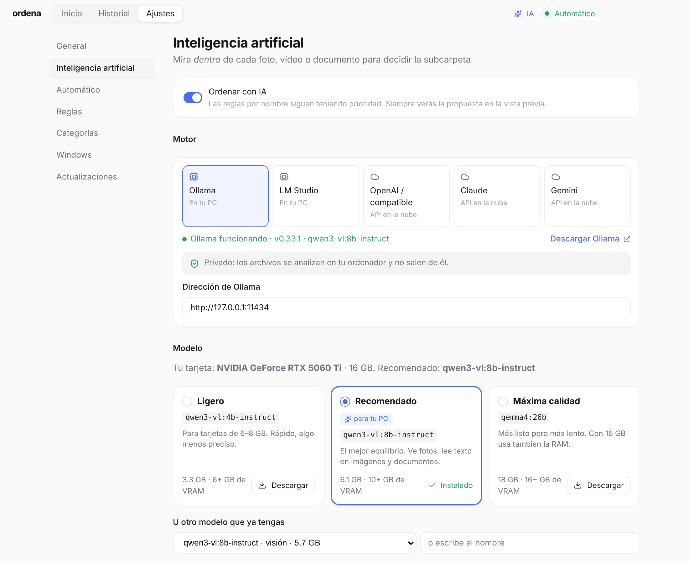

<div align="center">


# Ordena

**Arrastra archivos. Ordena los pone en su sitio.**
Organizador de archivos para Windows, minimalista, con IA local opcional para fotos, vídeos y documentos.



</div>

---

## ¿Qué hace?

Sueltas archivos o carpetas sobre la ventana y Ordena los mueve a una carpeta de destino, organizados así:

```
Ordenado/
├── Imágenes/
│   ├── Paisajes y viajes/2024/08 Agosto/   ← la IA ha mirado la foto
│   ├── Mascotas y animales/2025/02 Febrero/
│   └── Capturas/                            ← regla por nombre
├── Documentos/
│   ├── Facturas y recibos/                  ← la IA ha leído el PDF
│   └── Contratos y legal/
├── Vídeos/Personas y familia/2025/06 Junio/
├── Proyectos/
│   ├── React/mi-web/                        ← proyectos enteros, nunca se separan
│   ├── VB.NET/AppInventario/
│   └── Python/scraper/
├── Privado/                                 ← contenido íntimo detectado en local
└── Duplicados/
```

### Sin IA (siempre funciona)

- **Más de 20 tipos**: imágenes, vídeos, audio, documentos, libros, hojas de cálculo, código, 3D, fuentes, certificados digitales (FNMT, AutoFirma), modelos de IA (`.gguf`, `.safetensors`), bases de datos, correo, máquinas virtuales…
- **Proyectos de programación**: detecta React, Next.js, Vue, Angular, Svelte, Electron, Tauri, Node, VB.NET, C#, F#, Python, Django, Rust, Go, Java, Spring, Android, Flutter, Laravel, PHP, Ruby, Unity, Godot, Unreal, C/C++… y los mueve **enteros**.
- **Vista previa** antes de mover, con casillas para elegir.
- **Reglas por nombre**: «factura» → `Documentos/Facturas/{año}`, «WhatsApp» → `{categoria}/WhatsApp`…
- **Fotos y vídeos por año y mes** (usa la fecha EXIF de la cámara).
- **Duplicados**: detecta archivos idénticos por contenido (SHA-1).
- **Reconoce archivos sin extensión** leyendo sus primeros bytes.
- **Modo automático**: vigila Descargas y ordena lo que llega (espera a que termine la descarga).
- **Clic derecho del Explorador**: «Ordenar con Ordena».
- **Historial** con deshacer, aunque cierres la app.
- **Nunca toca** descargas a medias (`.crdownload`, `.part`), `desktop.ini` ni archivos `~$` de Office.



---

## La IA, explicada

La IA es **opcional**. Si la activas, Ordena no solo mira la extensión: **mira dentro** del archivo.



| Pieza | Qué hace | Dónde se ejecuta |
|---|---|---|
| **Filtro íntimo** ([nsfwjs](https://github.com/infinitered/nsfwjs)) | Detecta desnudos o contenido explícito y lo manda a `Privado`. Tiene prioridad sobre todo lo demás. | Siempre en tu PC (GPU vía WebGL). Nunca sale a internet. |
| **Modelo de visión** | Mira la foto (o 3 fotogramas del vídeo) y elige una carpeta de tu lista. | Ollama / LM Studio (local) o una API en la nube. |
| **[Laya](https://github.com/NandhaKishorM/laya)** (opcional) | Lee el texto de un documento y elige carpeta en milisegundos. Si duda, pide segunda opinión al modelo. | En tu PC (Python). |

**Las carpetas las decides tú.** En *Ajustes → Inteligencia artificial* puedes editar la lista de carpetas para fotos, vídeos y documentos, con una pista para la IA («perros, gatos y cualquier animal»). La IA solo puede elegir de tu lista: Ordena se lo exige con un *JSON schema*, así que nunca inventa carpetas.

Las respuestas se guardan en caché: volver a analizar el mismo archivo es instantáneo.



### ¿Qué modelo uso?

Ordena detecta tu tarjeta NVIDIA y te recomienda uno. Puedes descargarlo con un clic desde la propia app.

| Tu tarjeta gráfica (VRAM) | Modelo | Descarga | Notas |
|---|---|---|---|
| 6–8 GB | `qwen3-vl:4b-instruct` | 3,3 GB | Rápido, algo menos preciso |
| **10–16 GB** (p. ej. RTX 5060 Ti 16 GB) | **`qwen3-vl:8b-instruct`** | 6,1 GB | **Recomendado**: rápido, buena visión y lee texto en imágenes |
| 16 GB + 32 GB RAM / 24 GB+ | `gemma4:26b` | 18 GB | Más listo y más lento; con 16 GB usa también la RAM |
| Sin GPU | API en la nube | — | Ver abajo |

> Usa siempre la variante **`-instruct`** de Qwen3-VL: la variante *thinking* razona en voz alta y es mucho más lenta para clasificar.

### Usar una API en la nube (opcional)

Si no tienes tarjeta gráfica, o prefieres más calidad, puedes usar:

- **OpenAI o cualquier API compatible**: OpenRouter, Groq, DeepSeek, Together, un servidor `llama.cpp`…
- **Claude** (Anthropic)
- **Gemini** (Google)

Pega la clave en *Ajustes → IA*. Se guarda **cifrada** con el almacén seguro de Windows (DPAPI) y nunca se muestra en la interfaz. Ordena lista los modelos disponibles de tu cuenta para que elijas uno con visión.

**Privacidad con APIs**: el filtro íntimo se ejecuta **siempre en local antes de enviar nada**, así que lo detectado como íntimo nunca llega a la API. Solo se envía una versión reducida de la foto (máx. 896 px) o el texto inicial del documento.

---

## Instalación

### Para usar

1. Descarga `Ordena-Setup-x.y.z.exe` desde [la última versión](https://github.com/TeamLabStudios/ordena/releases/latest).
2. Instálalo. Windows puede avisar porque el instalador no está firmado: *Más información → Ejecutar de todas formas*.
3. Las siguientes versiones se instalan solas: Ordena las busca en GitHub al arrancar.

### Para la IA local (opcional)

**Ollama** (recomendado)
1. Instala [Ollama](https://ollama.com/download) y ábrelo.
2. En Ordena: *Ajustes → Inteligencia artificial → Descargar* en el modelo recomendado.
   (o en una terminal: `ollama pull qwen3-vl:8b-instruct`)

**LM Studio**: carga un modelo con visión y activa el servidor en *Developer → Start Server*.

**Laya** (opcional, para documentos)
```bash
pip install "laya[serve]"
laya-serve        # escucha en http://127.0.0.1:8000
```

---

## Desarrollo

Necesitas Node.js 20+.

```bash
git clone https://github.com/TeamLabStudios/ordena.git
cd ordena
npm install
npm start          # compila la interfaz y abre la app
npm run dist       # crea el instalador de Windows en release/
```

Para publicar una versión: sube `version` en `package.json`, ejecuta `npm run dist` y crea una Release `vX.Y.Z` en GitHub adjuntando `Ordena-Setup-X.Y.Z.exe`, su `.blockmap` y `latest.yml`. Las apps instaladas se actualizarán solas.

```bash
# (opcional) publicar directamente con un token: GH_TOKEN=... npx electron-builder --win --publish always
```

### Estructura

```
electron/
  main.cjs        Proceso principal: ventana, bandeja, IPC, vigilancia de carpetas, menú contextual
  engine.cjs      Motor: planifica (qué va a dónde), ejecuta, historial y deshacer
  ai.cjs          IA: proveedores (Ollama, LM Studio, OpenAI, Claude, Gemini, Laya), caché, GPU
  categories.cjs  Categorías por extensión y archivos que nunca se tocan
  projects.cjs    Detección de proyectos de programación
  sniff.cjs       Reconocimiento de archivos por su contenido (firmas)
  preload.cjs     Puente seguro entre interfaz y proceso principal
src/
  App.jsx         Pantalla principal
  Preview.jsx     Vista previa
  History.jsx     Historial
  Settings.jsx    Ajustes
  AISettings.jsx  Ajustes de IA
  worker.js       Ventana oculta: abre imágenes y vídeos, filtro NSFW en GPU
```

**Cómo fluye un archivo**: `plan()` decide el destino de cada archivo (regla → IA → tipo → fecha → duplicado) sin tocar nada → vista previa → `execute()` mueve y guarda la tanda en el historial para poder deshacerla.

Stack: Electron · React · Vite · lucide-react · exifr · pdf.js · mammoth · TensorFlow.js + nsfwjs.

---

## Privacidad

- Sin telemetría. Sin cuentas. Sin conexión salvo que elijas una API en la nube.
- Con Ollama, LM Studio o Laya, **ningún archivo sale de tu PC**.
- La configuración vive en `%APPDATA%\Ordena\` (`config.json`, `history.json`, `ai-cache.json`).

## Licencia

[MIT](LICENSE)
